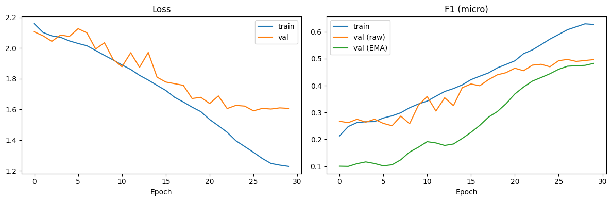
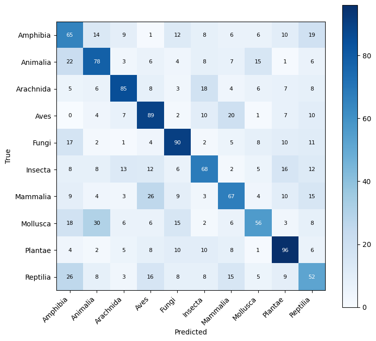

# Flora & Fauna Image Classification

A convolutional neural network **trained entirely from scratch** (no transfer learning, no transformers) that classifies photos into 10 taxonomic groups of animals, fungi and plants. Built with PyTorch and scored with F1.

## Task

| Label | Class | Label | Class |
|:-----:|-------|:-----:|-------|
| 0 | Amphibia | 5 | Insecta |
| 1 | Animalia | 6 | Mammalia |
| 2 | Arachnida | 7 | Mollusca |
| 3 | Aves | 8 | Plantae |
| 4 | Fungi | 9 | Reptilia |

- **Train:** 9,999 images in 10 class folders (about 1,000 each)
- **Test:** 2,000 unlabeled images; the output is a `submission.csv` with columns `Image_ID`, `Label`
- **Metric:** F1 (micro-averaged in the notebook, which equals accuracy for single-label classification)

## Approach

**Model**: a 2.5M-parameter residual CNN with squeeze-and-excitation attention.

```
Input 160x160x3
 -> ConvBlock(3 -> 32)  + MaxPool
 -> ConvBlock(32 -> 64) + MaxPool
 -> ConvBlock(64 -> 128) + MaxPool
 -> ConvBlock(128 -> 256) + MaxPool
 -> ConvBlock(256 -> 256)
 -> Global average pool
 -> Dropout(0.4) -> Linear(256, 256) -> ReLU -> Dropout(0.4) -> Linear(256, 10)

ConvBlock = Conv3x3-BN-ReLU -> Conv3x3-BN -> SE block -> (+ 1x1 skip) -> ReLU
```

**Training**

| Setting | Value |
|---------|-------|
| Split | 85 / 15 stratified train / validation, seed 42 |
| Optimiser | AdamW, lr 1e-3, weight decay 1e-4 |
| Schedule | OneCycleLR, peak lr 3e-3, 25% warm-up, stepped per batch |
| Loss | Cross-entropy with label smoothing 0.05 |
| Batch / epochs | 64 / 30 (early stopping patience 12) |
| Precision | Mixed precision (AMP) |
| Augmentation | Random horizontal flip, rotation (10 degrees), colour jitter |
| Weight averaging | EMA of weights (decay 0.999), raw vs EMA compared each epoch |
| Inference | Test-time augmentation: average softmax of image + horizontal flip |

## Results

Best validation micro-F1: **0.497** (epoch 27, raw weights). Training took about 35 minutes on a single Kaggle T4 GPU.

| Class | Precision | Recall | F1 |
|-------|:---------:|:------:|:--:|
| Amphibia | 0.374 | 0.433 | 0.401 |
| Animalia | 0.500 | 0.520 | 0.510 |
| Arachnida | 0.630 | 0.567 | 0.596 |
| Aves | 0.506 | 0.593 | 0.546 |
| Fungi | 0.566 | 0.600 | 0.583 |
| Insecta | 0.496 | 0.453 | 0.474 |
| Mammalia | 0.479 | 0.447 | 0.462 |
| Mollusca | 0.523 | 0.373 | 0.436 |
| Plantae | 0.568 | 0.640 | 0.602 |
| Reptilia | 0.354 | 0.347 | 0.350 |
| **Macro avg** | **0.499** | **0.497** | **0.496** |





**Observations**

- Plantae, Arachnida and Fungi are the easiest classes; Reptilia and Amphibia are the hardest and are often confused with each other and with Animalia.
- Train F1 (0.63) is above validation F1 (0.50), so the model is starting to overfit while still being capacity- and data-limited. Longer schedules, stronger augmentation (random-resized crop, mixup/cutmix) and ensembling several from-scratch models are the obvious next steps.
- The EMA weights lagged the raw weights for the whole run (only about 4,000 update steps with decay 0.999), so the best checkpoint came from the raw weights. A lower decay would likely help.

## Repository structure

```
.
├── notebooks/
│   └── flora_fauna_cnn.ipynb   # data loading, model, training, evaluation, submission
├── assets/                     # training curves and confusion matrix
├── requirements.txt
├── LICENSE
└── README.md
```

## Running it

**On Kaggle (recommended):** create a notebook inside the competition, upload `notebooks/flora_fauna_cnn.ipynb`, enable a GPU, and run all cells. The data folder is detected automatically under `/kaggle/input`.

**Locally:**

```bash
python -m venv .venv
source .venv/bin/activate          # Windows: .venv\Scripts\activate
pip install -r requirements.txt
jupyter notebook notebooks/flora_fauna_cnn.ipynb
```

Point `DATA_DIR` in the data-detection cell at a folder that contains `train/` (one sub-folder per class) and `test/` (all test images), and optionally `sample_submission.csv`. Set `DRY_RUN = True` first for a quick end-to-end check.

## Notes on the constraints

No pretrained weights are loaded anywhere and no transformer layers are used. The `IMAGENET_MEAN` / `IMAGENET_STD` values in the notebook are only generic RGB normalisation constants.

## License

[MIT](LICENSE)
